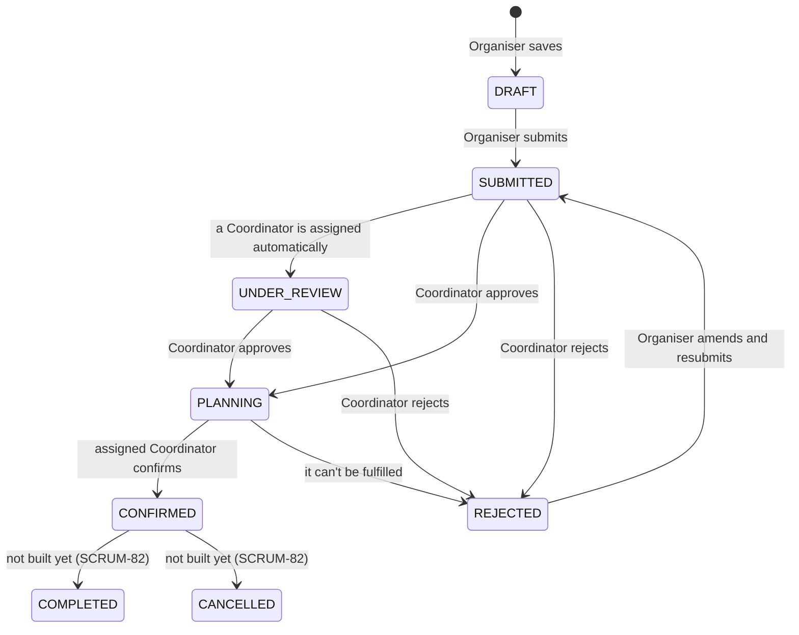

# ConnectSphere — product context

The product on one page: who uses it, what Release 1 delivers, what it
deliberately leaves out, and how an event moves from request to confirmed.
Read it before your first story, and when you need to explain the system as
a whole.

It summarises and links; it doesn't replace the sources:

- **The customer's own words:** the briefing, the Week 4 project instructions
  and the Q&A answers are in the team's
  [shared Google Drive folder](https://drive.google.com/drive/folders/1G4cNyWOcldw0iawiJfmJ1WbCiy_YZbv0).
- **Acceptance criteria and status:** Jira, mirrored in
  [`docs/backlog/`](backlog/README.md). This page never copies criteria or
  statuses, because they change.
- **What the code does:** the code. If this page disagrees with it, the page
  is wrong: fix it in the same PR.

---

## The problem

ConnectSphere Event Services plans events and runs its own venues in
Singapore. Today an event is coordinated across email, spreadsheets,
calendars and chat, so requests arrive incomplete, nobody is sure what has
been approved, and the same venue or equipment gets promised twice.
Double-booked venues are the customer's top complaint (ADR 0010).

This system replaces all of that with one place where every event has one
status, one assigned Coordinator, and arrangements that can't clash.

## Who uses it

| Role | Internal? | What they do in the system | Lands on |
|---|---|---|---|
| **Event Organiser** | External client | Creates event requests (as drafts first), submits them, answers the Coordinator's clarification questions, and follows their own events. Sees only their own events. | My Events |
| **Event Coordinator** | ConnectSphere staff | Is assigned to a submitted request automatically (until SCRUM-165, when new requests go to the Lead's unassigned queue instead, per Week 7 change 5), reviews it, asks for clarification, approves or rejects it, requests a venue and equipment, and confirms the event once the arrangements are complete. Sees the events assigned to them, and submitted ones nobody is assigned to yet. | Events |
| **Venue Staff** | ConnectSphere staff | Reviews venue booking requests and approves or rejects them, and records when a venue is unavailable (maintenance, closure). | Bookings |
| **Technical Support Staff** | ConnectSphere staff | Reviews equipment requests, checks equipment availability, and reserves what was approved. | Equipment |
| **Attendee** | External | Browses events open for registration, registers, and sees their own registrations. Never sees internal planning information. | Browse Events |
| **Event Coordinator Lead** | ConnectSphere staff | Will review new requests' basic details in an unassigned queue, assign each to a Coordinator and reassign where needed (SCRUM-165, SCRUM-21), and see every Coordinator's assignments and active events (SCRUM-141). Can't approve or reject a request, or confirm, plan or edit an event. The role exists since SCRUM-172; until SCRUM-164 and SCRUM-165 land it only reads its own notifications. | Notifications |
| **Safety Officer** | ConnectSphere staff | Will review an event's venue and equipment arrangements before it can be confirmed, and approve, reject or request changes on that safety check (SCRUM-166). Can't confirm, plan or edit the event: its approval doesn't confirm it; the Coordinator still does (SCRUM-166 AC14). The role exists since SCRUM-172; until SCRUM-164 and SCRUM-166 land it only reads its own notifications. | Notifications |

Each account has one role today. The customer has said an account may hold
several, which is in the backlog (SCRUM-121).

What each role may do is one table, `ROLE_ACTIONS` in `lib/auth/can.ts`, and
every page and action checks it on the server (ADR 0004). An event you aren't
related to looks exactly like one that doesn't exist (SCRUM-68).

## How an event moves

There are exactly nine statuses (SCRUM-23), and every change goes through one
guarded gate that refuses a change based on a stale status (ADR 0006).

| Step | What happens | Stories, ADRs |
|---|---|---|
| **Draft → Submitted** | The Organiser can save an incomplete request and finish it later. Submitting needs every required field. | SCRUM-13, 14, 15 |
| **Assignment** | Submitting assigns a Coordinator automatically and moves the request to Under Review. There is no manual claim step. | SCRUM-20 |
| **Review** | The Coordinator can ask the Organiser a question and name the fields the answer may change. While a question is open the event stays Under Review; "awaiting clarification" is shown, not stored as a status. | SCRUM-17, 18, 108, ADR 0014 |
| **Approve** | Approval moves the event straight to **Planning**: "Approved means there is enough information to start planning." Approved is recorded in the history but never stored on its own. | SCRUM-19, 81, ADR 0012 |
| **Reject** | A rejection always has a reason and an outcome chosen by the Coordinator: **amend and resubmit** (back to the same Coordinator) or **submit as a new request** (a copy starts as a new Draft). | SCRUM-19, 126, 108, ADR 0013 |
| **Planning** | The Coordinator books one venue and raises one equipment request. Venue Staff and Technical Support decide them. A Planning event that can't be fulfilled is rejected, and its bookings and reservations are released in the same step. | SCRUM-50, 53, 27, 28, 117, ADR 0015 |
| **Confirm** | A readiness checklist shows what is still missing (the venue, and the equipment if any was requested). When it is complete, only the assigned Coordinator can confirm: "Confirmed means the essential arrangements are complete." | SCRUM-110, 81, ADR 0011, 0012 |
| **Registration** | Attendees register for an event open for registration, up to its expected attendance, within its registration period. | SCRUM-72 to 77 |

### Venue and equipment, step by step

- **A venue** is requested by the Coordinator for the event's period and
  decided by Venue Staff. An event has one venue. An approved booking blocks
  the venue for that period, and the database refuses a clash, even when two
  approvals happen at the same instant (SCRUM-50, 53, ADR 0010).
- **Equipment** is requested as lines (type, quantity, technical
  requirements). Technical Support reviews the request, and **approving it
  doesn't hold any stock**. Stock is held only when Technical Support reserves
  the approved request: in one step, pre-filled from the request, all or
  nothing (SCRUM-27, 28, 155). Approved requests are the only way to reserve;
  the equipment form only checks availability (SCRUM-156).
- **Equipment is a counted pool**, not individual items. Available means the
  pool minus what is reserved and what is in for maintenance over the period
  (SCRUM-29, ADR 0007).

## Release 1: the twenty features

The Week 4 project instructions name twenty features for Release 1. Each maps
to an epic in Jira; the stories carry the acceptance criteria.

| # | Feature | Epic | Main stories |
|---|---|---|---|
| 1 | User authorisation and authentication | SCRUM-9 Access Control | 65, 66, 67, 68, 69 |
| 2 | Event request creation | SCRUM-6 Event Request Lifecycle | 13, 14 |
| 3 | Draft event requests | SCRUM-6 | 15, 16, 130 |
| 4 | Event review and approval | SCRUM-6 | 17, 18, 19, 108, 126 |
| 5 | Coordinator assignment | SCRUM-6 | 20, 21 |
| 6 | Event status management | SCRUM-6 | 23, 24, 84, 81, 110, 117, 131, 135 |
| 7 | Event information management | SCRUM-6 | 25, 127 |
| 8 | Venue catalogue | SCRUM-7 Venue Management | 34 |
| 9 | Venue availability calendar | SCRUM-7 | 36, 37 |
| 10 | Venue search and filtering | SCRUM-7 | 38 |
| 11 | Venue suitability checking | SCRUM-7 | 40 |
| 12 | Venue booking request | SCRUM-7 | 50 |
| 13 | Venue booking approval | SCRUM-7 | 52, 53 |
| 14 | Booking conflict detection | SCRUM-7 | 53, 37, 134 |
| 15 | Equipment request management | SCRUM-10 Equipment Management | 27, 28, 142 |
| 16 | Equipment availability checking | SCRUM-10 | 29, 30 |
| 17 | Equipment reservation | SCRUM-10 | 31, 155, 156, 32 |
| 18 | Attendee registration | SCRUM-11 Attendee Registration | 72, 73, 74, 75, 76, 77, 133 |
| 19 | Event change requests | SCRUM-8 Event Change & Notifications | 41, 128, 26 |
| 20 | Notification system | SCRUM-8 | 45, 48, 85, 124 |

For which stories are done, in progress or still to do, see
[`docs/backlog/README.md`](backlog/README.md) or the Jira board. For the
tables behind each feature, see [`docs/data-model.md`](data-model.md).

## Out of scope for Release 1

The Week 4 instructions list features not required for Release 1, and the
team has descoped some stories (label `beyond-release-1` in Jira). Don't build
these unless the backlog brings them back:

- waiting lists (SCRUM-79) and recording attendance on the day (SCRUM-80);
- equipment catalogue maintenance as a feature (SCRUM-119): equipment rows
  come from the seed;
- an activity timeline (SCRUM-71). Recording who did what and when is still
  part of every story's Definition of Done, through the audit log;
- a single calendar of all events (SCRUM-120), finding an event by search
  (SCRUM-115), reminders about overdue arrangements (SCRUM-122) and
  preparation progress (SCRUM-123);
- event categories, agendas, recurring events, attachments, comments,
  tentative holds, room layouts as records, and reporting.

## Words that are easy to mix up

| Word | Means |
|---|---|
| **Event request** | An `Event` row before approval. There is no separate request table. |
| **Booking** | A **venue** for an event's period. Pending, then approved or rejected by Venue Staff. |
| **Equipment request** | What the Coordinator asks for: lines of equipment type and quantity. Approving it holds no stock. |
| **Reservation** | **Equipment** actually held for an event's period. Stored as `CONFIRMED`; SCRUM-131 will show it as **Reserved** everywhere, so it isn't confused with an event's Confirmed status. The readiness checklist already says Reserved. |
| **Planning** | The status after approval, while the venue and equipment are arranged. |
| **Confirmed** | The event's arrangements are complete. Only the assigned Coordinator can confirm. |

## Open questions

Decisions the team made where the customer hasn't confirmed them yet. Each is
recorded where it applies; check the Q&A answers in the Drive folder before
building on one.

- **"Awaiting clarification" is not a status** (data model, decision 4.2).
  If the customer wants it as a status, it becomes a tenth value.
- **Requests are decided in the order they were made** (SCRUM-134, not built).
  Approving an equipment request holds no stock, so a later request could be
  reserved first until it is.
- **All event times are Singapore time** (SCRUM-129): ConnectSphere's venues
  are in Singapore.
- **Account creation.** Users come from the seed, and the backlog has no
  story for signing up yet (SCRUM-153).
